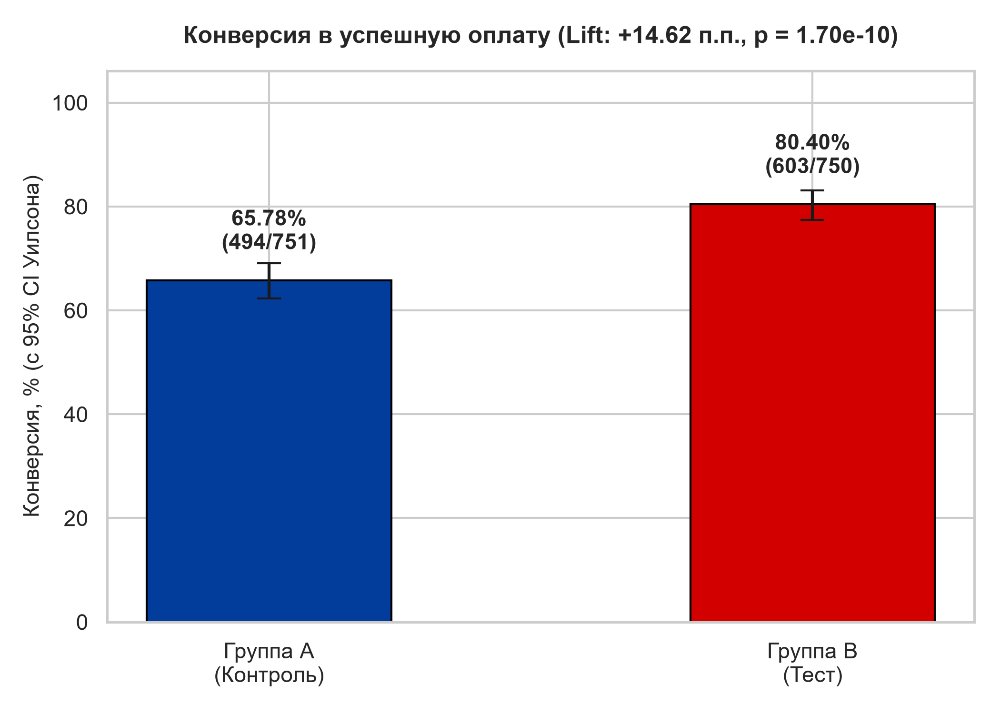
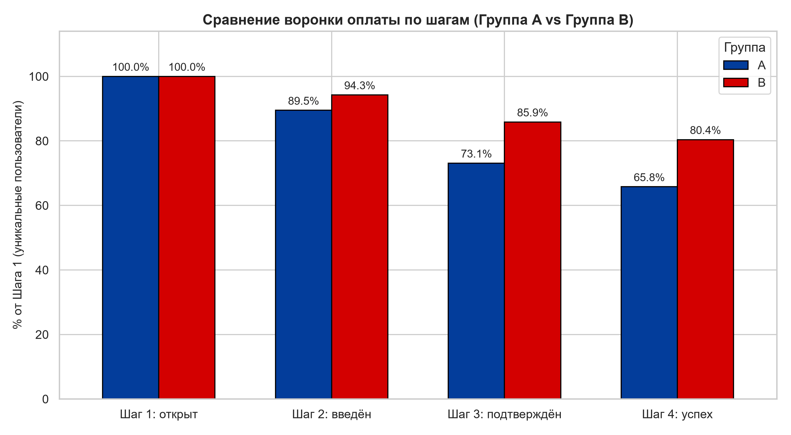

# A/B-тестирование платёжной воронки

Аналитическое исследование влияния нового сценария оплаты (группа B) на конверсию в успешную транзакцию по сравнению с контрольным вариантом (группа A). Проект включает автоматизированный аудит качества логов, проверку баланса выборки, статистическую оценку результатов и визуализацию воронки.



## 1. Задача и дизайн эксперимента

* **Цель:** оценить эффективность обновлённого платёжного сценария и принять решение о раскатке изменений на всю аудиторию.
* **Единица рандомизации и анализа:** уникальный пользователь (`user_id`), поскольку один клиент мог совершать несколько попыток оплаты за период эксперимента.
* **Целевая метрика (CR):** доля пользователей экспериментальной выборки, совершивших хотя бы одну успешную оплату (`step4_success`).
* **Статистические гипотезы (α = 0.05):**
  * $H_0: p_B = p_A$ — новый платёжный сценарий не влияет на конверсию;
  * $H_1: p_B \neq p_A$ — конверсия в тестовой группе статистически значимо отличается от контрольной.

## 2. Структура входных данных

*Исходный файл датасета исключён из репозитория через `.gitignore`.*

1. **`users` (Пользователи):** профиль участников эксперимента — `user_id`, `group` (`A` / `B`), `age`, `city`, `device_type`.
2. **`payments` (Платежи):** лог прохождения этапов оплаты с временными метками — `payment_id`, `user_id`, `group`, `step1_opened`, `step2_entered`, `step3_confirmed`, `step4_success`.

## 3. Аудит и очистка данных (Data Quality)

В модуле `src/analyzer.py` реализована автоматическая валидация сырых данных перед расчётом метрик:

1. **Аномалии возраста:** исключены 2 записи с невалидными значениями (`age = -5` и `age = 150`).
2. **Пропуски в сплитовании:** исключён 1 пользователь без назначенной группы (`group = NaN`).
3. **Ошибки логирования платежей:**
   * исключена транзакция без идентификатора пользователя (`user_id = NaN`);
   * выявлено расхождение тега группы между таблицами (`user_id = 1010` отнесён к группе `A` в `users`, но к группе `B` в `payments`). В качестве эталона использована группа из таблицы пользователей.
4. **Проверка корректности сплита (SRM):** после очистки в выборку вошёл **1 501 пользователь** (**751** в группе A и **750** в группе B). Распределения по возрасту (среднее 32.74 и 32.65 года), устройствам и городам сбалансированы.

## 4. Результаты эксперимента

Для оценки разницы долей применён двусторонний Z-тест, для оценки неопределённости эффекта рассчитан 95% доверительный интервал (метод Вальда).

| Показатель | Группа A (Контроль) | Группа B (Тест) |
| :--- | :---: | :---: |
| Уникальных пользователей (n) | 751 | 750 |
| Успешных плательщиков (k) | 494 | 603 |
| **Конверсия в оплату (CR)** | **65.78%** | **80.40%** |
| **Абсолютный прирост (Lift)** | — | **+14.62 п.п.** |
| **95% Доверительный интервал** | — | **[+10.20; +19.05] п.п.** |
| **Z-статистика / p-value** | — | **Z = 6.39 / p = 1.70e-10** |



## 5. Выводы и рекомендации

1. **Внедрять новый сценарий (группу B) на 100% аудитории:** прирост конверсии составил **+14.62 п.п.** и является статистически значимым (p = 1.70 ⋅ 10⁻¹⁰ < 0.05). Нижняя граница 95% доверительного интервала находится на уровне **+10.20 п.п.**, что гарантирует выраженный положительный эффект.
2. **Точка роста на этапе ввода данных:** детальный разбор воронки показывает, что основной вклад в итоговый прирост даёт переход с открытия формы (`step1_opened`) к вводу платёжных реквизитов (`step2_entered`).
3. **Технические рекомендации:** передать команде разработки баг-репорт по рассинхронизации тегов A/B-групп в сервисе логирования платежей (`user_id = 1010`) и добавить валидацию возраста при регистрации.

## 6. Структура репозитория и запуск

```text
├── data/                  # Директория для локального файла date.xlsx
├── reports/               # Сгенерированные графики (ab_conversion.png, funnel_chart.png)
├── src/
│   ├── analyzer.py        # Валидация данных, расчёт Z-теста, CI и воронки
│   └── main.py            # Консольный отчёт и генерация графиков
├── .gitignore
└── requirements.txt
```

### Локальный запуск

```bash
git clone https://github.com<username>/payment-funnel-ab-test.git
cd payment-funnel-ab-test

python -m venv .venv
source .venv/bin/activate  # для Windows: .venv\Scripts\activate
pip install -r requirements.txt

# Поместите исходный файл date.xlsx в папку data/ и запустите:
python -m src.main
```
